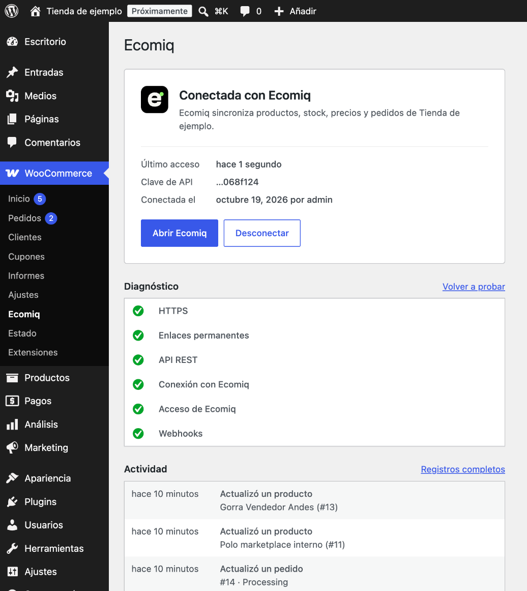
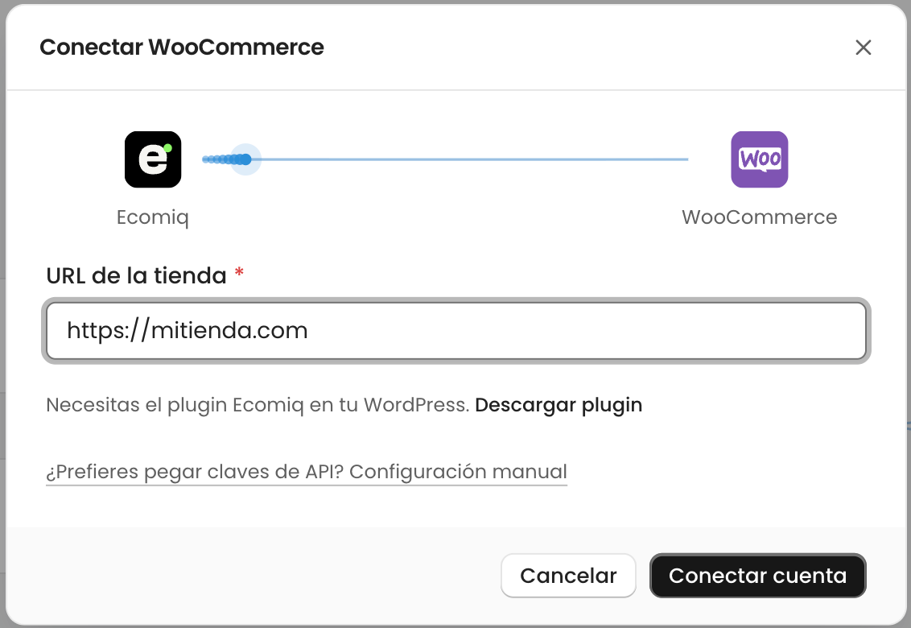
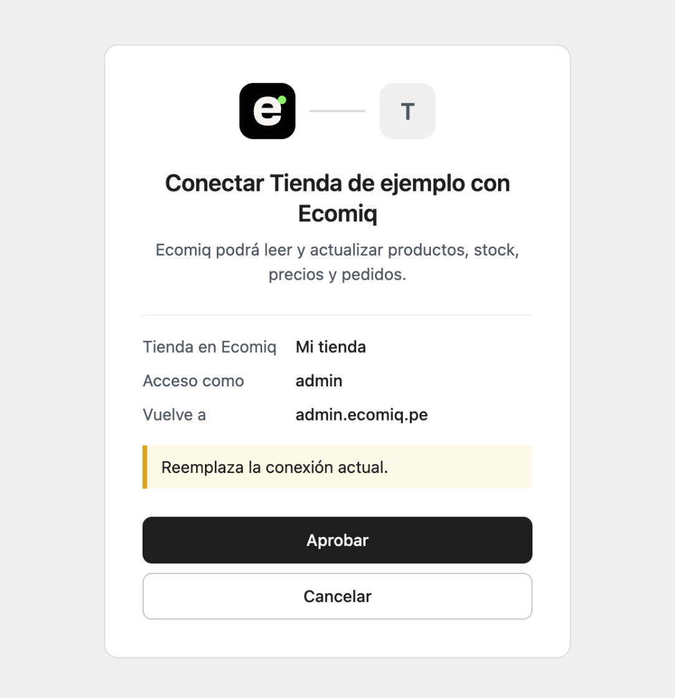
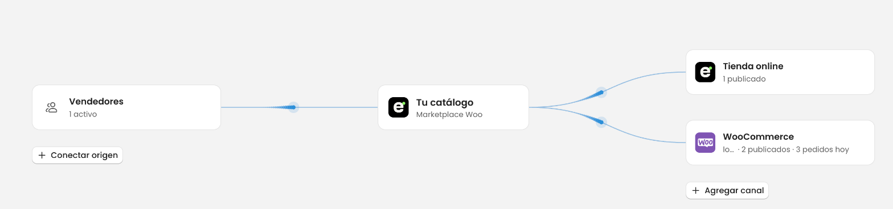

# Ecomiq para WooCommerce

Conecta tu tienda WooCommerce con [Ecomiq](https://ecomiq.pe) en un clic, sin copiar claves de API.

**[Descargar la última versión](https://github.com/ecomiq/ecomiq-woocommerce/releases/latest/download/ecomiq-for-woocommerce.zip)** · [Documentación](https://docs.ecomiq.pe) · [Panel de Ecomiq](https://admin.ecomiq.pe)

## Qué hace

Ecomiq reúne catálogo, stock, precios y pedidos de todos tus canales en un solo panel. Con este plugin, tu WooCommerce entra a Ecomiq de dos formas:

- **Como origen.** Ecomiq trae tus productos con variantes, categorías, atributos y fotos, además del stock y los pedidos. Los cambios llegan por webhooks.
- **Como canal de venta.** Ecomiq publica productos de su catálogo en tu WooCommerce, mantiene al día precio y stock, y recibe los pedidos. En un marketplace, un pedido con productos de varios vendedores se convierte en un pedido por vendedor.

En WordPress, el plugin agrega una página en **WooCommerce → Ecomiq** con:

- **Conexión en un clic.** Apruebas en WordPress y Ecomiq recibe su propia clave de API.
- **Actividad.** Qué cambió Ecomiq en tu tienda, qué solicitudes fallaron y qué webhooks no llegaron.
- **Diagnóstico.** Revisa HTTPS, enlaces permanentes, la API REST y los webhooks. Si un firewall o plugin de seguridad bloquea a Ecomiq, dice cuál es y qué IP permitir.
- **Webhooks que se recuperan solos.** WooCommerce apaga un webhook tras 5 fallas seguidas. El plugin vuelve a activar los de Ecomiq a los 15 minutos.
- **Pedidos de otros canales sin cobros.** Cuando vendes un producto de tu tienda en otro canal, Ecomiq crea el pedido con el pago y el envío a nombre del canal donde se vendió (por ejemplo «Shopify»): no aparecen en tu checkout, no cobran envío y el comprador no recibe correos de tu tienda. Una nota dice dónde se vendió y con qué número, y la columna **Origen** de WooCommerce muestra el canal.
- **Envío de Ecomiq.** Agrega el método «Ecomiq» a una zona de envío y el checkout cobra las tarifas que configuraste en Ecomiq: un envío por vendedor, con su transportista. Si Ecomiq no responde, cobra la tarifa de respaldo que pongas en la zona.
- **Estados a tu medida.** Si tu tienda usa estados propios (por ejemplo «Despachado»), en Ecomiq eliges qué significa cada uno al recibir pedidos y cuál usar al actualizarlos.
- **Desconexión limpia.** Borra la clave de API y los webhooks de Ecomiq. Tus productos y pedidos no cambian.

## Instalación

1. [Descarga el zip](https://github.com/ecomiq/ecomiq-woocommerce/releases/latest/download/ecomiq-for-woocommerce.zip) y súbelo en **Plugins → Añadir nuevo → Subir plugin**. Actívalo.
2. En Ecomiq, entra a **Canales → Agregar** y elige WooCommerce como origen o como canal de venta.
3. Escribe la URL de tu tienda y pulsa **Conectar cuenta**.

   

4. WordPress muestra qué tienda de Ecomiq pide acceso y con qué usuario. Pulsa **Aprobar**.

   

5. Vuelves a Ecomiq con la tienda conectada y eliges qué productos traer o publicar.

   

## Requisitos

| | Versión mínima |
|---|---|
| WordPress | 6.5 (probado hasta 7.1) |
| WooCommerce | 9.0 (probado hasta 11.2) |
| PHP | 7.4 |
| Sitio | HTTPS y enlaces permanentes |

## Detalles técnicos

### Conexión

OAuth 2.0 con PKCE (S256). El plugin es el servidor de autorización y Ecomiq el cliente.

1. Ecomiq lee `GET {tienda}/wp-json/ecomiq/v1/status` y lleva al navegador a `authorize_url` con `redirect_uri`, `state`, `code_challenge`, `code_challenge_method=S256` y `store`.
2. El plugin solo acepta `redirect_uri` igual a `{servidor}/connect/woocommerce`. El servidor es `https://admin.ecomiq.pe` salvo que se cambie en **Avanzado**.
3. Al aprobar, el navegador vuelve con `code` y `state`. El código vence a los 10 minutos y sirve una sola vez.
4. Ecomiq canjea el código con `POST {rest_url}ecomiq/v1/token` y su `code_verifier`, y recibe la clave de API.

Hay una clave por tienda: reconectar crea una nueva y borra la anterior. El canje exige HTTPS; solo un WordPress con `WP_ENVIRONMENT_TYPE` = `local` lo acepta sin HTTPS.

### API REST

| Ruta | Uso |
|---|---|
| `GET /wp-json/ecomiq/v1/status` | Versión del plugin, nombre de la tienda, `authorize_url`, `rest_url`, servidor de Ecomiq y si hay HTTPS. |
| `POST /wp-json/ecomiq/v1/token` | Canjea el código de autorización por la clave de API. |
| `GET /wp-json/ecomiq/v1/order-statuses` | Estados de pedido de la tienda, incluidos los que agregan otros plugins. Exige la clave de API de Ecomiq. |

### Envío

Cuando la zona de la dirección usa el método `ecomiq_rates`, el plugin manda a Ecomiq los productos del carrito (IDs, SKU, cantidad y precio) y la dirección de envío, firmados con el secreto de los webhooks de Ecomiq. Ecomiq responde un grupo por vendedor con sus tarifas, y el plugin arma un paquete por grupo. Cada tarifa guarda en la línea de envío del pedido la meta `ecomiq_rate`, oculta en la pantalla del pedido, con la que Ecomiq sabe qué método y transportista eligió el comprador. La respuesta se reutiliza 10 minutos mientras el carrito y la dirección no cambien.

### Qué guarda en tu tienda

- Una clave de API de WooCommerce de lectura y escritura, a nombre del usuario que aprobó.
- Los webhooks de productos y pedidos que registra Ecomiq (`product.*`, `order.*`).
- Las opciones `ecomiq_connection`, `ecomiq_settings` y `ecomiq_activity` (últimos 50 eventos). La actividad también va al registro de WooCommerce con origen `ecomiq`.

Al desinstalar el plugin se borran la clave, los webhooks y las opciones.

### Privacidad

Ecomiq lee y actualiza productos, stock, precios y pedidos, incluidos nombre, correo, teléfono y direcciones del cliente de cada pedido. Si una zona usa el método de Ecomiq, el checkout también le manda el carrito y la dirección de envío para calcular el envío. El plugin agrega ese texto a la guía de privacidad de WordPress. Ecomiq trata los datos según su [política de privacidad](https://ecomiq.pe/privacidad).

## Enlaces

- [Ecomiq](https://ecomiq.pe): el sitio, con [precios](https://ecomiq.pe/precios) y [contacto](https://ecomiq.pe/contacto).
- [Panel de Ecomiq](https://admin.ecomiq.pe): donde conectas y administras tus canales.
- [Documentación](https://docs.ecomiq.pe): guías y referencia de la API.
- [Términos](https://ecomiq.pe/terminos) y [privacidad](https://ecomiq.pe/privacidad).

## Desarrollo

Entorno local, datos de prueba, revisión y cómo sacar una versión: [docs/desarrollo.md](docs/desarrollo.md).

## Licencia

GPL-2.0-or-later. Ver [LICENSE](LICENSE).
